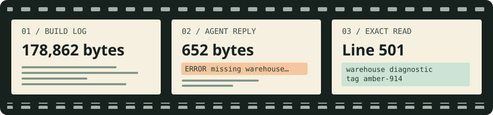
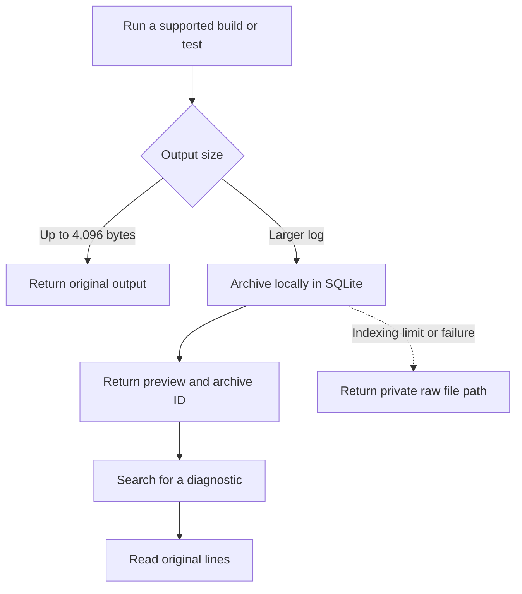

# ContactSheet

Keep the full build log on your machine. Give your coding agent a short failure report and let it look up the exact lines it needs.



[Install](#install-an-agent-plugin) · [Try it](#run-it) · [Model gateway](#self-hosted-model-gateway) · [Benchmarks](#measured-improvement) · [Coding guidance](#built-in-coding-guidance) · [Architecture](ARCHITECTURE.md)

## Install an agent plugin

From the ContactSheet checkout, use Node.js **24.12+ (24.x with FTS5)** and **pnpm 10.13.1**. Install dependencies once, then select your host. For example, to use Gemini CLI:

```sh
pnpm install --frozen-lockfile
pnpm plugin gemini
```

Restart the host, approve the plugin or hooks if prompted, and look for `context_search` in its tools.

<details>
<summary><strong>Install commands for all 11 hosts</strong></summary>

| Host | Install |
| --- | --- |
| Codex | `pnpm plugin codex` |
| Gemini CLI | `pnpm plugin gemini` |
| Qwen Code | `pnpm plugin qwen` |
| Pi | `pnpm plugin pi` |
| OMP | `pnpm plugin omp` |
| OpenCode 2 | `pnpm plugin opencode` |
| GitHub Copilot CLI | `pnpm plugin copilot` |
| Kiro CLI | `pnpm plugin kiro` |
| VS Code with Copilot | `pnpm plugin vscode` |
| IntelliJ IDEA (Junie or AI Assistant) | `pnpm plugin intellij /path/to/project` |
| ZCode | `pnpm plugin zcode` |

**IntelliJ IDEA.** Pass the directory you open in the IDE. The installer registers Junie in that project or prints merge instructions for an existing configuration. For AI Assistant, paste the printed JSON into **Settings → Tools → AI Assistant → Model Context Protocol (MCP) → Add → STDIO**. Keep the checkout in place and use the CLI pipe below for build capture. [Junie setup](https://junie.jetbrains.com/docs/junie-ide-plugin.html) · [AI Assistant setup](https://www.jetbrains.com/help/ai-assistant/mcp.html)

**Kiro IDE.** Run `pnpm plugins:pack`, import `dist/plugins/portable` under **Powers → Add Custom Power**, and use the CLI pipe for capture.

**Updates.** Keep Node 24 on the host’s PATH. Gemini, Qwen, Pi and OMP can link the checkout. Keep it at a stable path and rebuild to refresh linked packages. Reinstall copied packages or remove them through the host’s plugin manager. Remove duplicate manual registrations when switching to a plugin.

</details>

## Run it

Try a two-line log from the checkout:

```sh
pnpm build
printf 'PASS cache\nERROR checkout timed out\n' | pnpm --silent ctx index --source checkout
pnpm --silent ctx search 'checkout timed out'
```

The search returns the archive ID and line number. In a connected agent using the same archive, ask:

> Read the line containing “checkout timed out” from the checkout log.

Or use `pnpm --silent ctx read <archive-id> --line 2 --count 1`. For an existing file, run `pnpm --silent ctx index build.log`.

<a id="self-hosted-gemini-gateway"></a>

## Self-hosted model gateway

Start one local gateway per provider from the ContactSheet checkout. Use the same absolute database path for the gateway and the agent’s ContactSheet MCP tools so the agent can recover archived turns with `context_read`.

| Client | Provider | Example launch command |
| --- | --- | --- |
| Codex CLI | OpenAI Responses | `pnpm ctx gateway --provider openai --port 8788 --budget 32000 --db /path/to/archive.sqlite` |
| Claude Code | Anthropic Messages | `pnpm ctx gateway --provider anthropic --port 8789 --budget 32000 --db /path/to/archive.sqlite` |
| Gemini CLI | Gemini Developer API (default) | `pnpm ctx gateway --port 8787 --budget 32000 --db /path/to/archive.sqlite` |

Run `pnpm build` first. In a second terminal, start the client from the target project. These examples use provider API credentials. Choose a model your API account can access and a budget large enough for the client's instructions and tools.

**Codex CLI.** Add this provider table to `~/.codex/config.toml`, then launch `codex -c 'model_provider="contactsheet"' -m YOUR_API_MODEL` with `OPENAI_API_KEY` set. This selects the gateway for that invocation.

```toml
[model_providers.contactsheet]
name = "ContactSheet"
base_url = "http://127.0.0.1:8788/v1"
env_key = "OPENAI_API_KEY"
wire_api = "responses"
```

**Claude Code.** With `ANTHROPIC_API_KEY` set, launch `ANTHROPIC_BASE_URL=http://127.0.0.1:8789 claude`.

**Gemini CLI.** In Gemini API-key mode, launch `GOOGLE_GEMINI_BASE_URL=http://127.0.0.1:8787 gemini`.

**What to expect.** The gateway counts input with the selected provider before generation. Over budget, it archives eligible older plain-text assistant replies, substitutes retrieval IDs and counts again. Instructions, user messages, the active exchange, calls, results and signed thinking blocks stay intact. HTTP 413 means the protected context exceeds the budget. Codex uses HTTP Responses streaming and explicit client-managed history. Server-managed conversations, stored prompts and previous-response references are outside this adapter.

The listener binds to IPv4 loopback. The default upstream is the selected provider’s API. **The provider receives the original input for counting**, including history later compacted for generation. To run a fixture or compatible server, pass its HTTPS origin or loopback HTTP origin via `--upstream`; it must implement both generation and token counting.

Generation responses include `x-contactsheet-input-tokens` and `x-contactsheet-archived`. Gateway stderr reports counts and elapsed time. Provider output streams through unchanged, including any usage and cache metrics. [OpenAI input token counting](https://developers.openai.com/api/reference/cli/resources/responses/subresources/input_tokens/methods/count) · [Anthropic token counting](https://platform.claude.com/docs/en/api/typescript/beta/messages/count_tokens) · [Gemini token counting](https://ai.google.dev/api/tokens)

## Automatic build and test capture



The hook preserves the command’s exit status. Simple foreground commands such as `pnpm run build`, `npm test`, `pytest` and `cargo build` are eligible on Bash or Zsh on macOS and Linux. For pipelines, compound commands or manual capture, pipe the output into ContactSheet:

```sh
set -o pipefail
pnpm test 2>&1 | pnpm --silent ctx index --source 'pnpm test' --session local
```

<details>
<summary><strong>Archive contents, limits and privacy</strong></summary>

The default archive is `.context/archive.sqlite`. Set `CONTEXT_DB` or pass `--db PATH` to choose another. The hook and MCP server must use the same archive. Its contents are plaintext and readable by every client connected to it. Use separate files to isolate projects.

CLI indexing returns a SHA-256 hash, source, session, timestamp, byte and line counts, and preview. Identical content and labels return the original receipt. Automatic capture combines stdout and stderr in write order. For output over 8 MiB or 100,000 lines, undecodable large output, or indexing failure, it returns a private raw file path beside the database. Keep the file for exact recovery.

</details>

## Measured improvement

In the 3,600-line failing-build fixture, the first reply identified the failure and preserved exit code 23. When the diagnostic on line 501 was missing from the preview, the agent could still search for its tag and read it.

| Task | Raw output | ContactSheet response | Fewer bytes |
| --- | ---: | ---: | ---: |
| Identify the build failure | 178,862 B | 652 B | **99.64%** |
| Also search for and read the omitted line | 178,862 B | 1,218 B total | **99.32%** |
| Read a short passing test run | 2,326 B | 2,326 B | 0% |

<details>
<summary><strong>Measurement conditions and coding-guidance comparison</strong></summary>

The Claude Code, Codex and Gemini hook tests each executed the same failing build once. Byte counts cover the receipt and, in the second row, both serialized MCP responses. They exclude prompts, requests and protocol framing. The searchable SQLite file occupied 987,136 bytes. Reading the whole log back into chat gives up the context saving. The passing-suite size varies with timing and runner formatting.

In a separate paired review on Apple silicon, both runs detected the two seeded queue-worker bugs and proposed fixes. The guided review also addressed a failed deletion after successful delivery.

| Same review task, fresh conversation | Defects found | Prompt tokens | Generated tokens | Total tokens |
| --- | ---: | ---: | ---: | ---: |
| Baseline review prompt | 2/2 | 188 | 2,432 | 2,620 |
| ContactSheet full policy + review workflow | 2/2 | 318 | 1,483 | 1,801 |

The guided run used **31.3% fewer total tokens** in this one pair. Broader effects on token use and defect detection remain unmeasured. To reproduce with LM Studio and the same installed model, run `pnpm build`, then `node scripts/benchmark-review.mjs lmstudio-community/Qwen3.8-27B-MLX-4bit`.

</details>

## Built-in coding guidance

Ask your agent to **review staged changes**, **audit the repository**, **list deferred shortcuts**, or **compare two benchmark runs**. The agent gets its workflow from `context_coding` and uses its own repository access. Skill-capable hosts also receive named skills for these workflows and help.

| Mode | What the agent focuses on |
| --- | --- |
| `lite` | Reuse existing code and verify the change concisely. |
| `full` (default) | Trace callers, stored data and failure paths. |
| `ultra` | First check whether configuration, deletion or an existing feature solves the task. |
| `off` | Disable coding guidance. |

Run `pnpm ctx coding` to see the current mode or `pnpm ctx coding lite` to change it. Agents sharing an archive share its setting. Set `CONTACTSHEET_CODING_LEVEL` to change the initial default. To print a workflow, run a command such as `pnpm ctx coding audit`.

<details>
<summary><strong>Compare runs or display a Claude Code session board</strong></summary>

**Measure a change.** Run the same acceptance checks against a baseline and a guided implementation. Save one JSON object per run, for example `{"task":"parser fix","passed":true,"lines":34,"seconds":120,"tokens":4100,"costUSD":0.04}`. Run `pnpm ctx compare baseline.json guided.json` for absolute and percentage differences. Only shared metrics are compared. A negative saving means the guided run used more.

**Claude Code session board.** Run `pnpm --silent ctx board config` from the checkout, optionally passing `--db /path/to/project/.context/archive.sqlite`. Merge the resulting statusLine entry into the Claude Code settings for that project. The display shows the coding level and usage supplied by Claude Code. Use `board off` or `board on` against the same archive to hide or restore it. To summarize historical JSONL transcripts, run `pnpm ctx board import --from /path/to/transcripts`. The archive stores per-session totals and identifiers. Reimporting refreshes those totals. `pnpm ctx board` displays the totals, with cost and API duration summed only from transcripts that report those values.

</details>

## Connect an agent

For manual MCP setup, run `pnpm --silent ctx init` and copy the printed `mcpServers` entry into the client. The command creates the project archive and prints absolute paths. Index large files through the CLI before their contents enter the conversation.

| Tool | Inputs | Result |
| --- | --- | --- |
| `context_index` | Text, optional source and session | Archive ID and preview |
| `context_search` | Query, optional ID and limit (1–50) | Ranked hits with source, line and excerpt |
| `context_read` | ID, optional line, count (1–200) and offset | Exact text and a cursor for the next page |
| `context_coding` | Optional level or action | Current policy or requested workflow |

<details>
<summary><strong>Manual hook setup for Claude Code, Codex and Gemini</strong></summary>

From the project you want to use with the agent, set `cli` to the absolute path of the built ContactSheet CLI. If you are working in the ContactSheet checkout itself, run:

```sh
cli="$PWD/apps/cli/dist/index.js"
```

**Claude Code.** Launch one session with the hook and the archive tools:

```sh
claude --settings "$(node "$cli" hook-config claude)" --mcp-config "$(node "$cli" init)"
```

For persistent project setup, merge the generated hook group into `.claude/settings.local.json` and the MCP entry into `.mcp.json`. Choose one registration method per project.

**Codex CLI.** To register the MCP server from the ContactSheet checkout, run:

```sh
codex mcp add contactsheet -- "$(command -v node)" "$PWD/apps/cli/dist/index.js" serve --db "$PWD/.context/archive.sqlite"
```

For a project with no existing hooks file, create it with the following commands. The subshell protects an existing file from being overwritten.

```sh
mkdir -p .codex
(set -C; node "$cli" hook-config codex > .codex/hooks.json)
```

If the file already exists, run `node "$cli" hook-config codex` and append the generated group to its `hooks.PreToolUse` array. Register the archive in the same project's `.codex/config.toml` under `[mcp_servers.contactsheet]`, using the `command` and `args` from `node "$cli" init`. An existing registration for the same archive also works. Open Codex in the trusted project and review the hook in `/hooks`. A new session picks up the configuration.

**Gemini CLI.** From the target project, generate its workspace settings using the built CLI path set above. This includes both the `BeforeTool` hook for `run_shell_command` and the ContactSheet MCP server. Both use the same absolute archive path.

```sh
mkdir -p .gemini
(set -C; node "$cli" hook-config gemini > .gemini/settings.json)
```

If settings already exist, print the configuration with `node "$cli" hook-config gemini`, append the generated group to `hooks.BeforeTool`, and merge `mcpServers.contactsheet`. Start Gemini CLI in the trusted workspace and check the hook with `/hooks panel` and the archive tools with `/mcp`. Ask Gemini to run a test and search the captured log for a diagnostic. Gemini applies its command permissions to the resulting capture pipeline. In headless sessions the applicable policy must permit that pipeline, including output redirection. Background shell calls follow Gemini’s ordinary execution path.

[Claude Code hooks](https://code.claude.com/docs/en/hooks#pretooluse-decision-control) · [Codex hooks](https://learn.chatgpt.com/docs/hooks) · [Gemini CLI hooks](https://geminicli.com/docs/hooks/reference/)

</details>

## Verification

Run `pnpm test` to build the packages and exercise capture, search, exact reads, coding guidance and plugin integration. A separate 3,001-line fixture checks that all five seeded failures appear in the preview and that paged reads reconstruct every line.

[Architecture and limits](ARCHITECTURE.md) · [MIT license](LICENSE)
